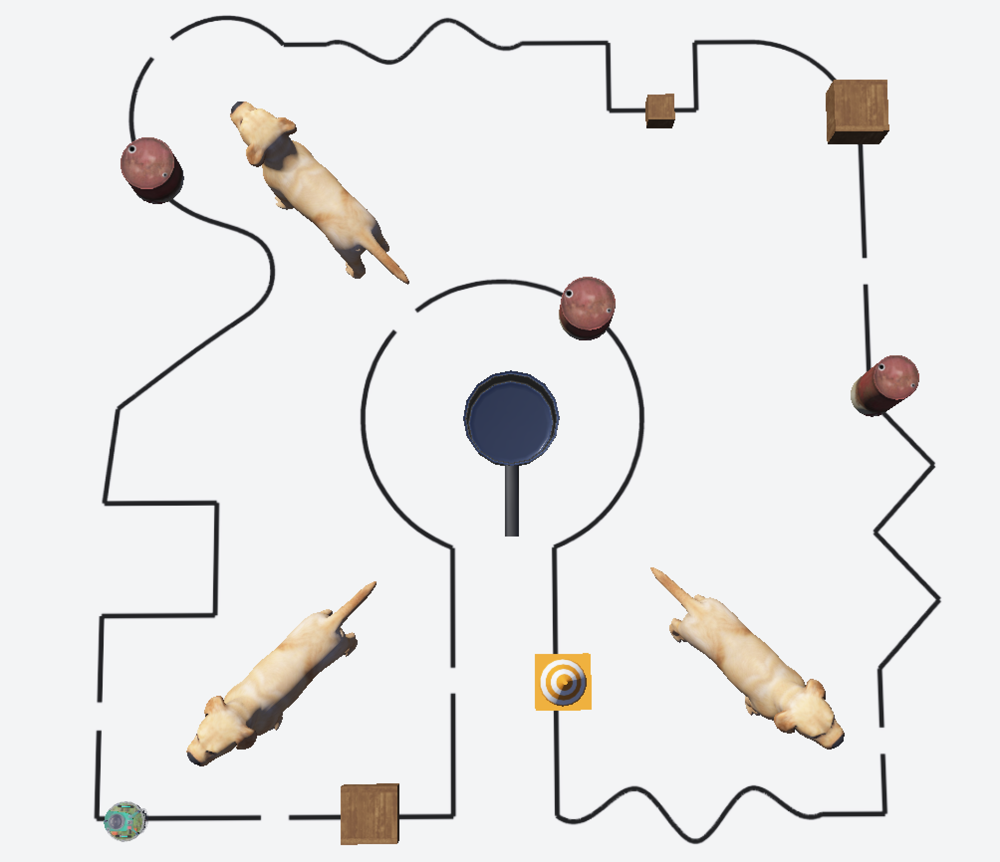
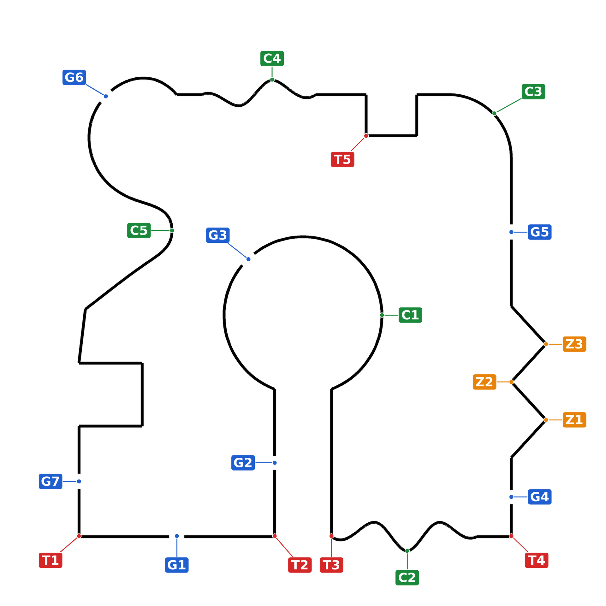
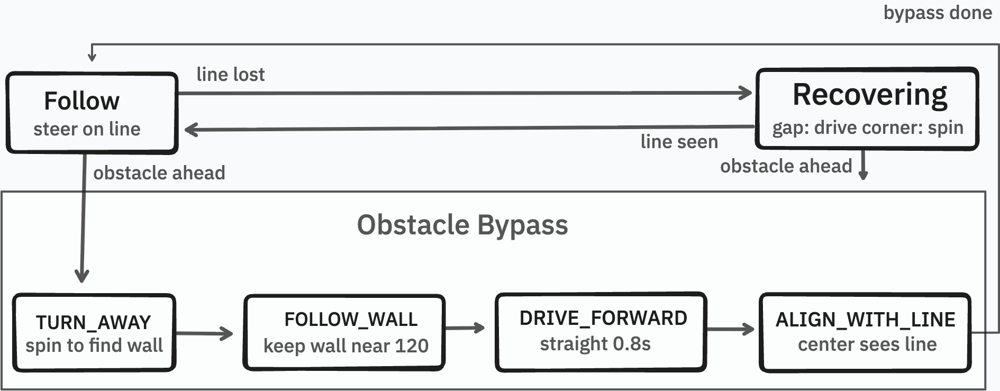
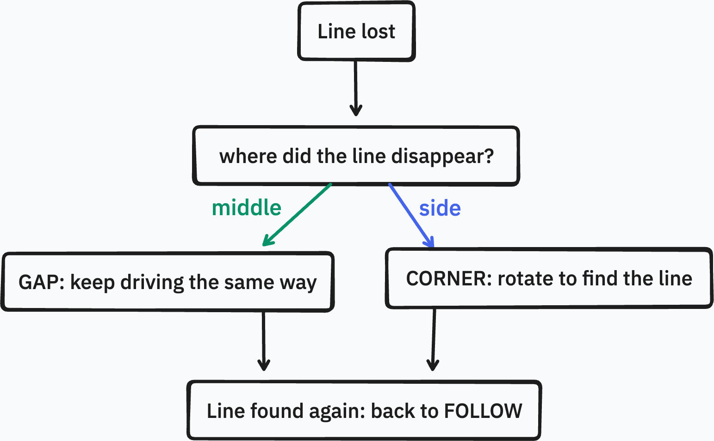
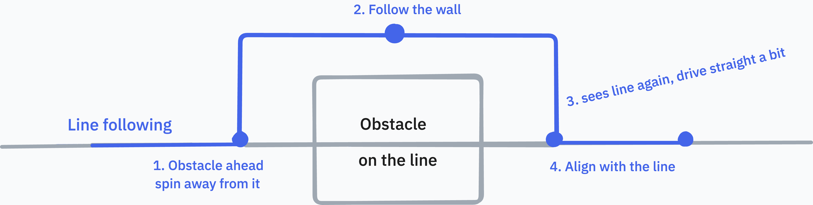

# Line Following Robot

This is a Webots simulation project where an e-puck robot follows a black line on the floor while handling obstacles, gaps, zigzags and sharp turns. The robot is controlled by a Python controller.

The main objectives are to make the robot follow the black line, handle gaps in straight and curved sections, detect and avoid obstacles and navigate the track successfully.

## Demo

View the full simulation here: https://youtu.be/71LjMyGEC_0

## Tools and setup

The project uses the following components and tools:

- Python 3.10 or newer
- Webots: Robot simulation environment
- E-puck robot: The robot used in the simulation
- Ground sensors (gs0, gs1, gs2): Detect the black line.
- Proximity sensors (ps0-ps7): Detect nearby obstacles.

## Track

The robot drives on a single closed-loop track with curves, sharp turns, gaps and zigzags, as shown below:

The main features of the track are listed below:

| Label | Feature | What it tests |
|---|---|---|
| C1 to C5 | Curves | Smooth steering and speed control on bends |
| T1 to T5 | Sharp turns | The line slips out from under the robot at a corner |
| G1 to G7 | Gaps in the line | Driving blind for a short distance |
| Z1 to Z3 | Zigzags | Quick left/right changes in direction |

Gaps appear on both straight lines (G1, G2, G4, G5, G7) and curves (G3, G6). On a curve the robot must keep turning while it crosses the gap, so it keeps driving with its recent average steering. In the simulation, obstacles are placed at several points along the track, and the robot drives around each one and returns to the line.

## Controller

I developed a Python controller for the e-puck robot. At each time step, it reads the sensors and adjusts the speed of the two wheels. The controller uses a state machine with six states, each with its own responsibility, which makes the code easier to read and maintain:

- FOLLOW: follow the line.
- RECOVERING: searches for the line when it is lost.
- TURN_AWAY: Turns away from an obstacle.
- FOLLOW_WALL: Moves around the obstacle
- DRIVE_FORWARD: Moves forward after passing the obstacle.
- ALIGN_WITH_LINE: Turn back towards the line to continue following it.

### Line Following

The robot uses three floor sensors to detect the line. A sensor detects black when its reading is below 550. Each reading is converted into a darkness value from 0 (white) to 1 (black).

The program uses these values to calculate the line position. A value of −1 means the line is on the left, 0 means it is in the center, and +1 means it is on the right. The robot adjusts its wheel speeds based on this position to steer toward the line. The steering strength is 0.9.

On the straight sections, the robot drives at a base speed of 2.2. When the line is far from the center, it slows down by up to half to handle sharp turns more smoothly. The program also keeps a running average of the steering values. If the robot loses the line, it uses this average to help it find the line again (Section 6).

### Line lost

The robot considers the line lost when all three floor sensors detect white. It ignores very short losses. If the line is still missing, it checks where it last saw the line to decide how to find it again. There are two possible cases:

- Gap: If the line was near the center before it disappeared, the robot moves forward slowly using its average steering. This helps it continue straight or keep turning in the same direction. If it cannot find the line within 2.6 seconds, it starts spinning to search for it.
- Corner: If the line was off to one side before it disappeared, the robot spins on the spot until one of the floor sensors detects the line again.

### Obstacles

The robot sees an obstacle when one of the four front proximity sensors reads above 100. When nothing is near, these sensors read about 65, and the reading grows as the obstacle gets closer.

First the robot chooses a side. If the left front reading is more than 20 higher than the right one, the obstacle is mostly on the left, so the robot turns right. Otherwise it turns left. Then it goes through four steps:

1. Turn away: The robot spins on the spot at speed 1.0 until the front is clear and the side sensor detects the obstacle. It does this for a maximum of 3.5 seconds.
2. Follow the wall: The robot moves along the obstacle while trying to keep a steady distance from it. If it gets too close, it steers away. If it gets too far, it steers closer. If it loses the obstacle, such as at a corner, it turns back toward it. It continues until it detects the line on the other side of the obstacle.
3. Drive forward: The robot moves straight for 0.8 seconds to make sure the whole robot passes the obstacle's corner.
4. Align with the line: The robot spins until only the center floor sensor detects the line. Then it returns to the normal line following.

The robot leaves the line, circles the obstacle and rejoins on the other side (Figure 4)

## How to Run

Make sure Webots and Python 3.10+ are installed. In Webots, configure the Python command under **Preferences > General > Python command** to point to your Python executable. See the [official Webots Python guide](https://cyberbotics.com/doc/guide/using-python) for details.

- Clone this repository or download and extract the zip file
- Open Webots and select **File > Open World** to open `worlds/line_follower.wbt`
- Press Run to start the simulation.

**Troubleshooting:** If the robot doesn't move, make sure `mero_controller` from `controllers/mero_controller` is attached to the e-puck

## Tuning

The robot's behaviour is controlled by several variables at the top of the controller. A few of the main ones are listed below, with values I tested and how they changed the robot performance.

| | Values | Result |
|---|---|---|
| BASE_SPEED | 1.2, 2.2, 2.8 | Robot moves faster but loses the line in sharp turns. Slower is more stable. |
| LINE_P_GAIN | 0.4, 0.9, 1.5 | Higher value turns the robot more sharply, causing wobble on straight parts. Lower value drives smoothly but turns too slowly in curves. |
| MAX_SLOWDOWN | 0.5 | Higher value slows the robot down more in sharp turns. |
| BYPASS_SPEED | 1.0, 1.2, 2.2 | Higher value makes the bypass faster but harder to follow the wall. Lower value is slower but safer. |
| WALL_P_GAIN | 0.005, 0.01, 0.03 | Higher value corrects the distance to the wall more strongly. Lower value corrects more gently. |

## References

- [Tldraw](https://www.tldraw.com/): used to draw the diagrams
- [Webots](https://cyberbotics.com/): used to build and test the robot in simulation